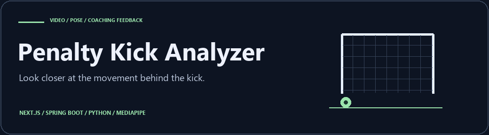
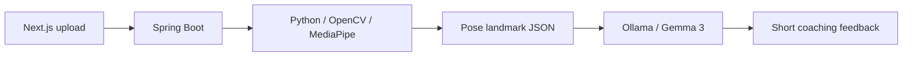

<div align="center">



# Penalty Kick Analyzer

**Look closer at the movement behind the kick.**


[Overview](#overview) &nbsp; · &nbsp; [Local setup](#local-setup) &nbsp; · &nbsp; [Explore the repository](https://github.com/mcampo0215/Penalty-Kick-Analyzer)

</div>

---

## Overview

A prototype that connects a Next.js video interface, a Spring Boot API, and a Python pose-extraction script. Video frames are processed with MediaPipe, then a local Ollama model is prompted to return a short penalty-kick coaching tip.

| Upload | Extract | Reflect |
| :--- | :--- | :--- |
| Submit a video through the web interface and Spring API. | Collect nose, foot, and hip positions from detected pose landmarks. | Send the pose JSON to a local model for brief coaching feedback. |

## How the pieces fit



## Local setup

You need Node.js/npm, **JDK 21**, PostgreSQL, an SMTP account for the authentication flow, Python with OpenCV and the MediaPipe `solutions.pose` API, and a running Ollama service with `gemma3:latest` available.

1. Configure the backend database, mail, and JWT properties using [application.sample.properties](backend/src/main/resources/application.sample.properties). Keep real credentials outside commits. The sample's first line is descriptive; use `spring.application.name` for an actual application name.
2. Update the Python interpreter and working-directory paths in [VideoController.java](backend/src/main/java/com/campoverde/AuthFeatures/controller/VideoController.java). They currently point to the original developer's local macOS environment. Point them at your environment and the repository's `analyzePos.py`.
3. Install compatible Python packages in that environment. The repo has no pinned Python requirements; newer MediaPipe APIs may require changes to this script.
4. Start the backend from `backend/`:

   ```powershell
   .\gradlew.bat bootRun
   ```

   On macOS/Linux, use `./gradlew bootRun`.

5. In a second terminal:

   ```sh
   cd frontend
   npm ci
   npm run dev
   ```

The frontend targets the backend at `http://localhost:8080`; Ollama is called at `http://localhost:11434/api/generate`. Align the frontend origin with the backend CORS configuration.

## Key sources

| Source | Responsibility |
| :--- | :--- |
| [frontend/src/app/videoCapture/page.tsx](frontend/src/app/videoCapture/page.tsx) | Video selection/capture interface and analysis request. |
| [VideoController.java](backend/src/main/java/com/campoverde/AuthFeatures/controller/VideoController.java) | Upload handling and Python process invocation. |
| [analyzePos.py](analyzePos.py) | Pose landmark extraction to JSON. |
| [LLMService.java](backend/src/main/java/com/campoverde/AuthFeatures/service/LLMService.java) | Prompt and Ollama request. |

## Current boundaries

This is a coaching-feedback experiment, not a validated biomechanics or ball-tracking system. The Python script extracts selected body landmarks; it does not detect the soccer ball or compute a measured scoring probability. Local paths and dependencies require configuration before the whole workflow can run. Authentication-related code is also included in the backend and frontend.

---

<p align="center"><a href="#penalty-kick-analyzer">Back to the top</a></p>
